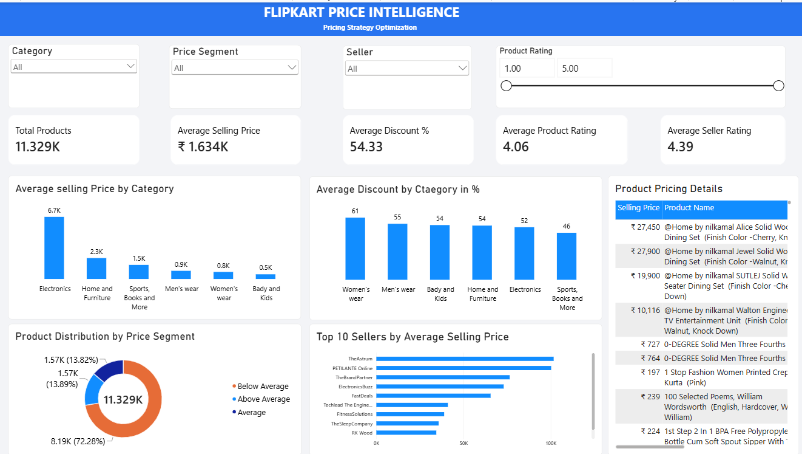

# Flipkart Price Intelligence: Pricing Strategy Optimization

An end-to-end data analytics project focused on analyzing product pricing, discounts, categories, and seller performance using Python, MySQL, SQL, and Power BI.

## Project Overview

This project explores Flipkart product data to understand pricing patterns, discount strategies, category-level trends, and seller performance. The analysis aims to identify useful pricing insights through data cleaning, exploratory data analysis, SQL queries, and an interactive Power BI dashboard.

## Objectives

* Analyze product prices and discount patterns across categories.
* Compare average selling prices and discounts.
* Examine seller-level pricing and ratings.
* Segment products based on category-level pricing.
* Build an interactive dashboard to explore pricing insights.

## Tools and Technologies

* **Python:** Data cleaning and exploratory data analysis
* **Pandas, NumPy:** Data manipulation
* **Matplotlib, Seaborn:** Data visualization
* **MySQL:** Data storage
* **SQL:** Business analysis and querying
* **Power BI:** Interactive dashboard

## Project Structure

```text
Flipkart-Price-Intelligence/
├── data/
│   ├── raw/
│   └── cleaned/
├── images/
│   └── dashboard.png
├── notebooks/
│   └── Flipkart_Price_Analysis.ipynb
├── powerbi/
│   └── Flipkart_Price_Intelligence.pbix
├── sql/
│   └── pricing_analysis.sql
├── load_to_mysql.py
├── README.md
└── requirements.txt
```

## Analysis Highlights

* Cleaned and prepared the product dataset for analysis.
* Calculated discount percentages and created price segments.
* Compared average selling price and discount across product categories.
* Analyzed seller pricing and seller ratings.
* Explored the relationship between product ratings and selling prices.
* Created SQL queries for pricing and seller performance analysis.
* Developed a single-page interactive Power BI dashboard with KPIs, slicers, charts, and product-level details.

## Dashboard Preview



## How to Run

1. Clone this repository:

   ```bash
   git clone https://github.com/shivanand-b/Flipkart-Price-Intelligence.git
   ```
2. Open the project folder:

   ```bash
   cd Flipkart-Price-Intelligence
   ```
3. Install the required Python libraries:

   ```bash
   pip install -r requirements.txt
   ```
4. Open the Jupyter notebook in `notebooks/` to explore the analysis.
5. Import the cleaned data into MySQL and run the queries in `sql/pricing_analysis.sql`.
6. Open the Power BI file in `powerbi/` to interact with the dashboard.

## Note

This project is intended for learning and portfolio demonstration. The findings describe patterns in the available dataset and should not be interpreted as live Flipkart prices or official company pricing decisions.

## Author

**Shivanand Prakash Birajdar**

* GitHub: [shivanand-b](https://github.com/shivanand-b)
* LinkedIn: [Shivanand Birajdar](https://linkedin.com/in/shivanand-birajdar-59276525b)
